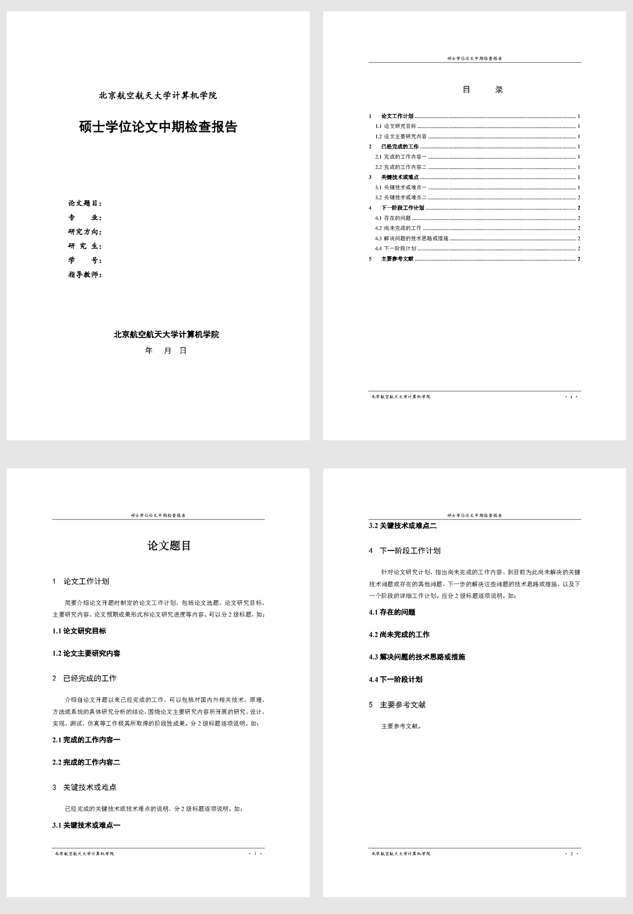

# 北京航空航天大学计算机学院硕士中期检查报告 LaTeX 模板

根据《附件2：中期检查报告模板（供参考）》制作，复现封面、目录和正文的字体、字号、间距、页眉页脚及页码样式。使用 **XeLaTeX** 编译，默认不显示封面标题后的“（模板）”。

[查看示例 PDF](output/pdf/main.pdf)



## 快速开始

1. 下载仓库：在 GitHub 页面选择 **Code → Download ZIP** 并解压，或使用 Git：

   ```bash
   git clone https://github.com/GGN-2015/buaa-middle-term-check-latex-template.git
   cd buaa-middle-term-check-latex-template
   ```

2. 安装包含中文支持的 TeX Live 或 MiKTeX，并确认能在终端运行 `xelatex`。
3. 编辑 `main.tex` 顶部的 `\ReportSetup`，填写封面信息，再替换正文中的说明文字。
4. 按下文的方法编译两次，更新目录和页码。

只需编辑 `main.tex` 即可完成一般写作；`buaa-midterm.cls` 负责排版。

## 项目文件

```text
.
├── main.tex                # 主文件：封面信息和正文
├── buaa-midterm.cls        # 文档类：字体和版式
├── build.ps1               # Windows 编译脚本
├── output/pdf/main.pdf     # 编译后的示例 PDF
├── docs/preview.png        # 四页预览图
├── README.md               # 使用说明
└── LICENSE                 # MIT 许可证
```

## 填写封面信息

将 `main.tex` 中的设置改为自己的信息：

```latex
\ReportSetup{
  title={这里填写论文题目},
  major={计算机科学与技术},
  direction={这里填写研究方向},
  author={姓名},
  student-id={学号},
  supervisor={导师姓名},
  year={2026},
  month={11},
  day={5},
  template-mark=false
}
```

| 字段 | 用途 |
| --- | --- |
| `title` | 论文题目，同时用于封面和正文首页 |
| `major` | 专业 |
| `direction` | 研究方向 |
| `author` | 研究生姓名 |
| `student-id` | 学号 |
| `supervisor` | 指导教师 |
| `year`、`month`、`day` | 报告日期，填写数字即可 |
| `template-mark` | `false` 隐藏封面的“(模板)”标记；`true` 显示标记 |

字段留空时，封面对应位置为空；`title` 留空时，正文首页显示“论文题目”。较长的题目会自动换行，正文首页的后续内容随之下移。

如需更改学院名称或报告名称，可在同一设置块中增加：

```latex
school={北京航空航天大学计算机学院},
report-name={硕士学位论文中期检查报告}
```

## 编写正文

正文保留原稿的五部分结构：论文工作计划、已经完成的工作、关键技术或难点、下一阶段工作计划、主要参考文献。将说明文字替换为自己的内容，使用标准章节命令组织报告：

```latex
\section{论文工作计划}

这里填写论文工作计划。

\subsection{论文研究目标}

这里填写研究目标。

\subsection{论文主要研究内容}

这里填写主要研究内容。
```

- 一级和二级标题自动编号，并自动加入目录。
- 封面不显示页码；目录使用小写罗马数字，从 `i` 开始；正文使用阿拉伯数字，从 `1` 开始。
- 示例在第 3.2 节前保留了一个 `\newpage`，用于复现原稿分页。正式写作时可删去，让正文自然分页。
- `\MakeReportCover`、`\tableofcontents`、`\MakeReportTitle` 分别生成封面、目录和正文首页题目，保留这三个命令及其顺序即可。
- 插入图片、表格或公式所需的宏包，可在 `\documentclass{buaa-midterm}` 后、`\begin{document}` 前加载。

## 编译方法

### Windows：使用脚本

在仓库目录打开 PowerShell，运行：

```powershell
powershell -ExecutionPolicy Bypass -File .\build.ps1
```

脚本调用 XeLaTeX 编译两次，更新目录，并将结果写入：

```text
output/pdf/main.pdf
```

辅助文件和编译日志保存在 `tmp/latex/`，该目录已加入 Git 忽略规则。

### Windows、macOS 或 Linux：使用命令行

在仓库目录运行两次：

```bash
xelatex -interaction=nonstopmode -halt-on-error main.tex
xelatex -interaction=nonstopmode -halt-on-error main.tex
```

这种方式生成的文件是仓库根目录下的 **`main.pdf`**，不会更新 `output/pdf/main.pdf`。目录或页码尚未更新时，再编译一次。

### TeX 编辑器

在 TeXstudio 或 VS Code LaTeX Workshop 中打开仓库，将主文件设为 `main.tex`，编译器设为 **XeLaTeX**，并编译两次。

### Overleaf

将仓库 ZIP 上传为项目，设置主文件为 `main.tex`、编译器为 **XeLaTeX**，然后编译。中文字体的选择见下一节；不需要运行 PowerShell 脚本。

## 字体与环境

模板优先使用与参考稿一致的字体：

| 用途 | 优先字体 | 自动回退字体 |
| --- | --- | --- |
| 正文 | 宋体 `SimSun` | FandolSong |
| 标题 | 黑体 `SimHei` | FandolHei |
| 封面信息、页眉页脚 | 楷体 `KaiTi` | FandolKai |
| 英文和数字 | Times New Roman | TeX Gyre Termes |

Windows 下安装了上述字体时，编译效果最接近参考稿。macOS、Linux 和 Overleaf 缺少这些字体时，模板自动使用回退字体，字形和换行会有差异。若需要一致的外观，请在具有相应使用权的前提下安装字体，并确保 XeLaTeX 能找到它们。仓库不包含系统字体文件。

主要依赖为 `ctex`、`xeCJK`、`fontspec`、`geometry`、`eso-pic`、`keyval`、`hyperref` 和 `iftex`。缺少宏包时，通过 TeX Live 或 MiKTeX 的包管理器安装；使用回退字体时还需安装 Fandol 和 TeX Gyre 字体包。

## 常见问题

### 提示找不到 `xelatex`

确认已安装 TeX Live 或 MiKTeX，且其可执行文件目录已加入 `PATH`。安装后重新打开终端，再运行 `xelatex --version` 检查。

### 提示只能使用 XeTeX，或出现中文字体错误

将编译器切换为 **XeLaTeX**，不要使用 pdfLaTeX 或 LuaLaTeX。字体缺失时，检查上述回退字体包是否已安装。

### 目录为空、目录页码不正确

连续编译两次；修改标题或较多正文后，必要时再编译一次。

### 修改后看到的 PDF 没有变化

使用 `build.ps1` 时查看 `output/pdf/main.pdf`；直接运行 `xelatex main.tex` 时查看根目录的 `main.pdf`。两种编译方式的输出位置不同。

### 编译失败，如何查看原因

脚本编译的日志位于 `tmp/latex/main.log`，直接编译的日志位于根目录 `main.log`。先处理日志中出现的第一个错误。

### 如何恢复封面“(模板)”标记

将 `main.tex` 中的 `template-mark=false` 改为 `template-mark=true`，再重新编译。

## 许可证

项目采用 [MIT License](LICENSE)。
